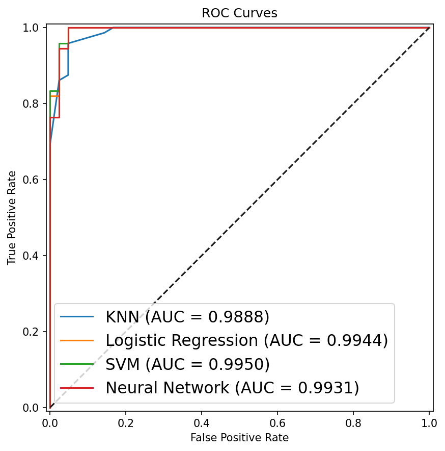
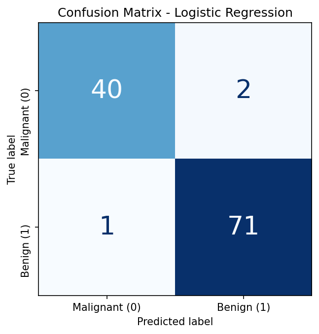
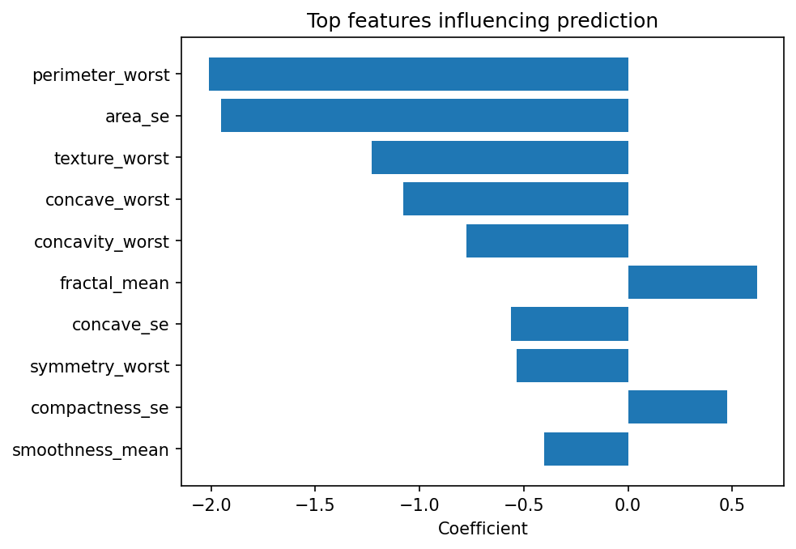

# Classifying Breast Cancer: KNN, Logistic Regression, SVM and Neural Network

Comparison of four supervised classification algorithms (K-Nearest Neighbours, logistic regression, support vector machine and a neural network) for distinguishing malignant from benign breast masses on the Breast Cancer Wisconsin (Diagnostic) dataset.

Group project for the Machine Learning course of the MSc in Health Data Science (MHEDAS), Universitat Rovira i Virgili.

## Overview

Early and accurate diagnosis is critical in breast cancer, and machine learning can support clinicians by classifying tumours from measurements of cell nuclei. This project builds and tunes four classifiers on 569 patient records, each described by 30 features computed from a digitised image of a fine needle aspirate (FNA) of a breast mass, and compares them on accuracy, macro F1, AUC and training time. 

## Results

All models were evaluated on a held-out test set of 114 patients (42 malignant and 72 benign), after tuning on the training set with 5-fold cross-validation.

| Model | Final settings | Accuracy | Macro F1 | AUC | Training time (s) | Test errors |
|-------|----------------|----------|----------|-----|-------------------|-------------|
| KNN | k = 9 | 0.9561 | 0.9531 | 0.9888 | 0.0027 | 5 |
| Logistic regression | C = 0.46 | 0.9737 | 0.9716 | 0.9944 | 0.0151 | 3 |
| SVM | RBF kernel, C = 10, gamma = 0.01 | 0.9737 | 0.9716 | 0.9950 | 0.0214 | 3 |
| Neural network | (128, 64, 32) hidden units, tanh, alpha = 0.001 | 0.9737 | 0.9716 | 0.9931 | 0.3129 | 3 |

Training times come from a single run and depend on the hardware.

Key findings:

- Logistic regression, SVM and the neural network reach the same accuracy (97.4%) and macro F1 (0.972), and the SVM has the highest AUC (0.995). The differences between these three are a single patient or less.
- Logistic regression is the model recommended for clinical use: it matches the more complex models, trains in a few hundredths of a second, and its coefficients can be inspected and explained.
- The strongest predictors of malignancy are `perimeter_worst`, `area_se`, `texture_worst`, `concave_worst` and `concavity_worst`, so tumour size and shape features dominate.
- The three best models each miss two malignant tumours (recall of 95% for the malignant class), which is the costlier error in a screening setting.







## Data

The data is the [Breast Cancer Wisconsin (Diagnostic)](https://archive.ics.uci.edu/dataset/17/breast+cancer+wisconsin+diagnostic) dataset from the UCI Machine Learning Repository: 569 records, 30 continuous features and no missing values. Each feature is the mean, standard error or worst (largest) value of ten measurements of cell nuclei, including radius, texture, perimeter, area, smoothness, compactness, concavity, concave points, symmetry and fractal dimension. The target is binary (212 malignant and 357 benign, about 37% and 63%).

The notebook loads it directly with `sklearn.datasets.load_breast_cancer()`.

## Methods

1. **Exploration:** feature distributions by class, which show that size and shape features (radius, perimeter, area and concave points) separate the classes best, and a correlation analysis that reveals strong multicollinearity.
2. **Split and scaling:** a stratified 80/20 train-test split (455 and 114 patients), with a `StandardScaler` fitted on the training set only.
3. **Feature reduction:** for each of the 21 feature pairs with correlation above 0.90 in the training set, the one less correlated with the target was removed, reducing 30 features to 20. All models use this reduced set.
4. **K-Nearest Neighbours:** k from 1 to 20. The value k = 9 was chosen from the accuracy curve, and a 5-fold grid search gave k = 8, which made more false alarms on the test set.
5. **Logistic regression:** the regularisation strength C swept over 10 values and chosen with 5-fold cross-validation (C = 0.46, CV accuracy 97.4%).
6. **SVM:** linear, RBF and polynomial kernels compared (test accuracy 0.965, 0.974 and 0.886), then a 5-fold grid search over C and gamma for the RBF kernel, which gave C = 10 and gamma = 0.01.
7. **Neural network:** `MLPClassifier` with seven architectures, three activation functions and four regularisation strengths, trained with Adam, early stopping on a 10% validation split and a maximum of 500 iterations.
8. **Comparison:** accuracy, macro F1, AUC, training time, ROC curves and confusion matrices.

The full methodology, results and discussion are in [`docs/classification_report.pdf`](docs/classification_report.pdf).

## Repository structure

```
.
├── docs/
│   └── classification_report.pdf
├── figures/          
├── notebooks/
│   └── supervised_classification.ipynb
├── README.md
└── requirements.txt
```

## How to run

```bash
git clone https://github.com/cindychenqiu/breast-cancer-classification.git
cd breast-cancer-classification
python -m venv .venv
source .venv\Scripts\activate # on macOS/Linux .venv/bin/activate 
pip install -r requirements.txt
jupyter notebook notebooks/supervised_classification.ipynb
```

Tested with Python 3.12.

## Limitations and next steps

- **Small test set:** the 114 test patients mean that one misclassification changes accuracy by about 0.9 percentage points, so the differences between the models are not statistically meaningful. Confidence intervals and nested cross-validation would give a more reliable comparison.
- **Some choices were guided by test accuracy:** the number of neighbours for KNN and the neural network activation function were selected by looking at test accuracy, so those results may be slightly optimistic.
- **Missed malignant tumours:** the best models miss two of the 42 malignant cases. Adjusting the decision threshold to favour sensitivity would be a natural next step.
- **Single dataset:** the features come from image measurements in one dataset, so the models need external validation before any clinical use.

## Authors and acknowledgements

Group project by Carla Bellido García, Celica Krigul, Keith Megara Osores Vicuña, Ema Štangová and Cindy Chen.  

[LinkedIn](https://www.linkedin.com/in/cindychenqiu/) | [GitHub](https://github.com/cindychenqiu)